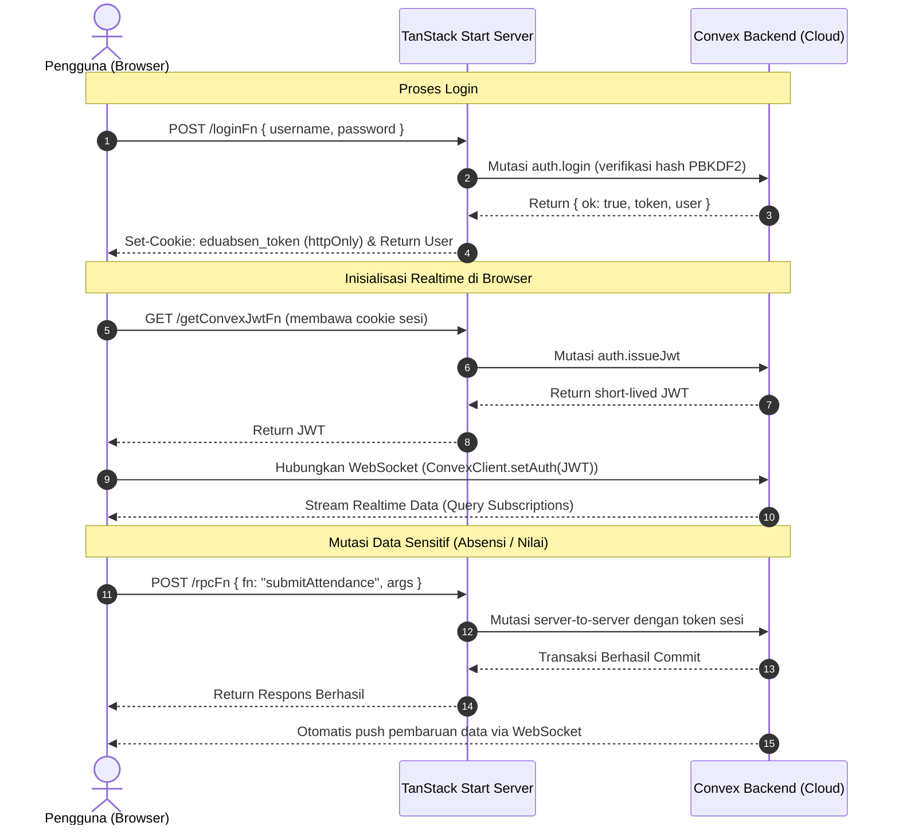

# Product Requirements Document (PRD)
# EduAbsen - Sistem Manajemen Kehadiran & Akademik Terintegrasi

| Metadata Dokumen | Deskripsi |
| :--- | :--- |
| **Nama Produk** | EduAbsen |
| **Versi Dokumen** | 1.1.0 |
| **Status Dokumen** | Disetujui / Aktif (Approved) |
| **Tanggal Pembaruan** | 16 November 2026 |
| **Arsitektur Utama** | Fullstack Web (TanStack Start + React 19 + Convex Database) |
| **Target Pengguna** | Administrator Sekolah, Guru Mata Pelajaran, Wali Kelas, Siswa |

---

## 1. Ringkasan Eksekutif & Latar Belakang

### 1.1 Latar Belakang Masalah
Pencatatan kehadiran dan administrasi nilai di institusi pendidikan sering kali masih mengandalkan lembar presensi fisik atau spreadsheet manual (seperti Google Sheets / Excel). Cara konvensional ini memiliki sejumlah kelemahan kritis:
1. **Risiko Integritas Data**: Mudah terjadi manipulasi catatan kehadiran dan nilai, serta rawan kehilangan data akibat human-error.
2. **Keterlambatan Pelaporan**: Pimpinan sekolah dan wali kelas kesulitan memantau absensi secara *realtime* (sering kali rekap baru diketahui pada akhir pekan atau akhir bulan).
3. **Penyalahgunaan Akun Siswa**: Penggunaan kata sandi statis tanpa kebijakan penguncian brute-force membuka celah peretasan akun oleh sesama siswa.
4. **Pengalaman Pengguna (UX) yang Lambat**: Sistem berbasis spreadsheet lambat diakses melalui perangkat seluler (smartphone) yang dibawa guru di dalam kelas.

### 1.2 Solusi Produk
**EduAbsen** hadir sebagai platform web terpadu yang memadukan kecepatan antarmuka modern dengan keandalan database realtime transaksional. Aplikasi ini mengintegrasikan seluruh siklus akademik harian: dari input absensi (harian dan mapel), pengerjaan tugas online dengan autosave mandiri, buku nilai berbasis KKM, hingga kenaikan kelas dan kelulusan siswa.

---

## 2. Tujuan Produk & Metrik Keberhasilan (KPIs)

| Sasaran / Tujuan | Metrik Keberhasilan (KPI) | Target |
| :--- | :--- | :--- |
| **Kecepatan Input Presensi** | Waktu yang dibutuhkan seorang guru untuk menyelesaikan absensi 1 kelas (30–40 siswa). | < 45 detik |
| **Nir-Kehilangan Data (Zero Data Loss)** | Tingkat kegagalan penyimpanan jawaban tugas siswa saat jaringan terputus. | 0% (didukung fitur autosave draf berkala) |
| **Visibilitas Kehadiran Realtime** | Waktu pembaruan statistik dashboard dari saat absensi disimpan oleh guru di kelas. | < 1 detik (sinkronisasi WebSocket) |
| **Ketahanan Keamanan Akun** | Pencegahan peretasan kata sandi melalui serangan brute-force. | Akun otomatis terkunci setelah 5× percobaan salah. |
| **Efisiensi Administrasi Nilai** | Waktu penyusunan rekapitulasi nilai akhir semester per mata pelajaran. | Instan (kalkulasi otomatis berdasarkan bobot & KKM) |

---

## 3. Profil Pengguna & Hak Akses (RBAC Matrix)

```
┌─────────────────────────────────────────────────────────────┐
│                    MATRIKS PERAN (RBAC)                     │
├─────────────────┬───────────┬───────────────┬───────────────┤
│ Fitur / Modul   │   Admin   │     Guru      │     Siswa     │
├─────────────────┼───────────┼───────────────┼───────────────┤
│ Dashboard Utama │ Full      │ Kelas Diampu  │ Kehadiran Prib│
│ Master Data     │ CRUD      │ Hanya Baca    │ Ditolak       │
│ Absensi Harian  │ Semua Kls │ Kelas Diampu  │ Rekap Pribadi │
│ Absensi Mapel   │ Semua Kls │ Mapel Diampu  │ Rekap Pribadi │
│ Kenaikan Kelas  │ CRUD      │ Ditolak       │ Ditolak       │
│ Kelulusan       │ Eksekusi  │ Ditolak       │ Ditolak       │
│ Manajemen Tugas │ Pantau    │ Buat & Nilai  │ Mengerjakan   │
│ Buku Nilai      │ Pantau    │ Atur & Input  │ Nilai Pribadi │
│ Pengaturan      │ Lembaga   │ Akun Sendiri  │ Akun Sendiri  │
└─────────────────┴───────────┴───────────────┴───────────────┘
```

### 3.1 Administrator (Admin)
- Bertanggung jawab atas pengelolaan master data institusi (data siswa, kelas, guru, mata pelajaran, penugasan pengampu).
- Melakukan eksekusi kenaikan kelas massal dan kelulusan siswa tingkat akhir.
- Mengatur konfigurasi global sekolah: nama institusi, NIP kepala sekolah, tahun ajaran aktif, semester, dan batas jendela edit absensi.
- Memiliki akses reset akun pengguna (guru dan siswa).

### 3.2 Guru
- Mengisi absensi harian untuk kelas yang diampu dan absensi per mata pelajaran sesuai jadwal.
- Membuat materi tugas/ujian online (CBT) baik bentuk pilihan ganda maupun esai.
- Menilai tugas esai siswa dan mengelola komponen buku nilai (KKM, bobot tugas, penilaian harian, UTS, UAS).
- Memantau tren dan laporan presensi kelas di bawah tanggung jawabnya.

### 3.3 Siswa
- Melihat rekap kehadiran harian dan kehadiran per mata pelajaran secara transparan.
- Mengikuti ujian dan mengerjakan tugas online dengan timer durasi pengerjaan.
- Memantau rekap nilai semester, status kelulusan KKM, dan predikat nilai akhir.
- Memperbarui kata sandi akun mandiri.

---

## 4. Kebutuhan Fungsional (Functional Requirements)

### Modul 1: Autentikasi & Keamanan Sesi
1. **Pola Multi-Identifier Login**:
   - Siswa login menggunakan NIS (Nomor Induk Siswa).
   - Guru dan Admin login menggunakan username atau NIP terdaftar.
2. **Keamanan Kredensial**:
   - Penyimpanan hash kata sandi menggunakan algoritma PBKDF2 dengan salt unik.
   - Dukungan migrasi otomatis kredensial lama (*hash algorithm upgrade*) saat pengguna berhasil login.
3. **Proteksi Brute-Force (Lockout)**:
   - Pelacakan percobaan login gagal berbasis kombinasi `username + IP address`.
   - Jika gagal melebihi batas (5 kali), akun terkunci sementara dengan durasi bertahap (*exponential backoff*).
   - Antarmuka menampilkan hitungan mundur (*countdown timer*) yang disinkronkan dengan jam server.
4. **Manajemen Sesi Hybrid (Server + Realtime)**:
   - Sesi autentikasi disimpan dalam cookie `httpOnly` dengan opsi `SameSite=Lax` dan durasi kedaluwarsa 6 jam.
   - Sesi tidak tersimpan di `localStorage` peramban untuk mencegah serangan XSS.
   - Server mengeluarkan token JWT jangka pendek untuk autentikasi koneksi realtime WebSocket Convex di sisi browser.
5. **Kebijakan Kata Sandi Awal**:
   - Akun siswa baru yang dibuat otomatis memiliki password awal sama dengan NISN.
   - Sistem mewajibkan pergantian password (`must_change_password: true`) saat pengguna pertama kali masuk dan memblokir navigasi ke halaman lain sebelum password diganti.

---

### Modul 2: Dashboard & Visualisasi Analitik
1. **Statistik Presensi Hari Ini**:
   - Menampilkan total siswa aktif, jumlah Hadir, Sakit, Izin, Alpa, dan persentase kehadiran hari berjalan.
   - Perhitungan mengambil ringkasan dari tabel agregasi harian (`attendance_daily`) untuk performa tinggi tanpa memindai seluruh rekaman presensi.
2. **Grafik Tren 7 Hari**:
   - Diagram batang kelompok menampilkan tren kehadiran vs ketidakhadiran selama 7 hari kalender terakhir.
3. **Diagram Donat Status Hari Ini**:
   - Visualisasi proporsi status kehadiran (Hadir, Sakit, Izin, Alpa) secara proporsional.

---

### Modul 3: Manajemen Master Data
1. **Data Siswa**:
   - Manajemen profil lengkap: NIS, NISN, Nama Lengkap, Jenis Kelamin (L/P), Tempat/Tanggal Lahir, Alamat, Nama & Telepon Orang Tua, Status Aktif.
   - Pembuatan akun siswa massal (*auto-generate*) dan tombol reset akun perorangan.
   - Halaman detail siswa menampilkan kartu riwayat kelas, rekapitulasi kehadiran tahun berjalan, daftar pengampu mapel, dan riwayat tugas.
2. **Data Kelas**:
   - Pengelolaan kelas per tingkat pendidikan (Tingkat 1 s/d 12), tahun ajaran, dan penunjukan guru wali kelas.
3. **Data Guru**:
   - Pengelolaan NIP, nama lengkap, kontak (email, telepon), dan status akun.
4. **Mata Pelajaran & Pengampu Mapel**:
   - Kode unik mata pelajaran (misal: MTK, IPA, BIND).
   - Pemetaan pengampu mengajar (*teaching assignment*) yang menghubungkan 1 Guru + 1 Mata Pelajaran + 1 Kelas.

---

### Modul 4: Manajemen Presensi (Absensi)
1. **Dua Mode Absensi**:
   - **Absensi Harian**: Pencatatan presensi umum kelas untuk satu hari sekolah.
   - **Absensi Mata Pelajaran**: Pencatatan presensi spesifik jam tatap muka mata pelajaran.
2. **Aturan Bisnis & Validasi Batas Waktu**:
   - Sistem menolak pengisian absensi untuk tanggal yang akan datang (*future dates*).
   - Validasi "Hari ini" disinkronkan dengan zona waktu sekolah (`tz_offset_minutes`), bukan jam lokal di perangkat klien.
   - Pengaturan jendela edit (*edit window days*): Guru dibatasi hanya boleh mengisi/mengedit absensi maksimal $N$ hari ke belakang. Admin memiliki hak istimewa tanpa batas hari.
3. **Status Kehadiran & Catatan Wajib**:
   - Pilihan status: **Hadir**, **Sakit**, **Izin**, **Alpa**.
   - Tombol cepat **"Tandai Semua Hadir"** untuk mempercepat proses entri kelas.
   - Setiap status non-Hadir (Sakit, Izin, Alpa) mewajibkan guru mengisi kolom keterangan (minimal 3 karakter) sebelum form dapat disimpan.
4. **Pembaruan Agregasi Harian Otomatis**:
   - Setiap mutasi absensi secara otomatis memperbarui angka rekapitulasi pada tabel `attendance_daily` secara atomik dalam satu transaksi database.

---

### Modul 5: Penugasan Siswa & Computer-Based Test (CBT)
1. **Pembuatan Tugas oleh Guru**:
   - Form pembuatan tugas mencakup judul, deskripsi instruksi, kelas target, mata pelajaran, batas waktu pengumpulan (*due date*), durasi pengerjaan (menit), dan status publikasi (*draft / published*).
2. **Manajemen Butir Soal**:
   - Mendukung 2 jenis soal: **Pilihan Ganda (Multiple Choice)** dan **Esai (Free-text Essay)**.
   - Pengaturan opsi jawaban (A, B, C, D, E), kunci jawaban, dan bobot poin per butir soal.
3. **Pelaksanaan Tugas Siswa**:
   - Verifikasi status pengerjaan: tugas hanya dapat dikerjakan jika status tugas dipublikasikan dan belum melewati batas tenggat.
   - Hitung mundur durasi pengerjaan (*countdown timer*) otomatis di sisi siswa.
   - Fitur **Autosave Draf Jawaban**: Jawaban siswa disimpan otomatis ke server setiap 25 detik serta saat jendela/tab diminimalkan (*visibilitychange*).
4. **Koreksi & Penilaian Guru**:
   - Soal pilihan ganda dinilai secara otomatis oleh server saat siswa menekan tombol serahkan (*submit*).
   - Antarmuka koreksi soal esai bagi guru dengan input skor parsial dan catatan umpan balik (*feedback*).
   - Status tugas bertahap: `Belum` $\rightarrow$ `Berlangsung` $\rightarrow$ `Diserahkan` $\rightarrow$ `Dinilai`.

---

### Modul 6: Buku Nilai (GradeBook) & KKM
1. **Konfigurasi Bobot & Komponen Nilai**:
   - Dikonfigurasi per pasangan Kelas dan Mata Pelajaran.
   - Nilai Kriteria Ketuntasan Minimal (KKM).
   - Daftar komponen nilai fleksibel (misal: Tugas Harian, PR, UTS, UAS) dengan bobot persentase total 100%.
   - Pilihan sumber komponen: **Tugas Otomatis** (rata-rata skor modul tugas CBT) atau **Manual** (diinput langsung oleh guru).
2. **Kalkulasi Nilai Akhir & Predikat**:
   - Perhitungan otomatis nilai akhir:
     $$\text{Nilai Akhir} = \sum (\text{Nilai Komponen}_i \times \text{Bobot}_i)$$
   - Penentuan status ketuntasan: **Tuntas** ($\ge \text{KKM}$) atau **Belum Tuntas** ($< \text{KKM}$).
   - Pemberian predikat kompetensi (A / B / C / D) berdasarkan interval skala nilai sekolah.

---

### Modul 7: Kenaikan Kelas & Kelulusan
1. **Kenaikan Kelas (Promosi Siswa)**:
   - Filter daftar siswa berdasarkan tingkat dan kelas asal.
   - Validasi kenaikan kelas: siswa hanya dapat dipromosikan jika tahun ajaran kelas sebelumnya telah selesai.
   - Eksekusi mutasi kelas menutup riwayat kelas lama (`is_active: false`, mencatat `end_date`) dan menambahkan riwayat kelas baru secara transaksional.
2. **Kelulusan Siswa Tingkat Akhir**:
   - Berlaku untuk siswa pada tingkat pendidikan tertinggi (misal: Kelas 6 SD, Kelas 9 SMP, Kelas 12 SMA).
   - Menandai siswa sebagai lulus (`graduated_at`, `graduated_year`), menonaktifkan status aktif, dan mencabut sesi login aktif siswa.

---

### Modul 8: Pelaporan & Rekapitulasi
1. **Laporan Absensi Siswa**:
   - Filter fleksibel berdasarkan rentang tanggal (*start date* s/d *end date*) dan kelas.
   - Filter parameter disimpan dalam query URL (*search params*) sehingga hasil filter dapat dibagikan (*shareable/bookmarkable*).
2. **Rekapitulasi Kehadiran Mata Pelajaran**:
   - Matriks kehadiran rekapitulasi jam pertemuan per siswa.
3. **Dukungan Cetak Fisik**:
   - *Print stylesheet* (`@media print`) khusus yang menghilangkan elemen navigasi, menu samping, dan tombol aksi, sehingga laporan siap dicetak rapi ke format PDF atau kertas fisik.

---

## 5. Kebutuhan Non-Fungsional (Non-Functional Requirements)

### 5.1 Performa & Latensi
- Waktu respon query realtime data master pada koneksi standar: $< 200 \text{ ms}$.
- Pemuatan halaman awal memanfaatkan preloading data pada server TanStack Start.
- Cache query di browser dikelola otomatis oleh TanStack Query dengan `staleTime: 30000` ms untuk mengurangi beban lalu lintas jaringan berulang.

### 5.2 Keamanan Data
- Enkripsi transmisi data menggunakan TLS/HTTPS.
- Seluruh mutasi database divalidasi ganda: validasi skema frontend (TanStack Form + Zod) dan validasi hak akses serta batas nilai di backend Convex (*defense in depth*).
- Penghapusan token sesi secara menyeluruh (*cookie destruction*) saat pengguna keluar atau mengganti kata sandi.

### 5.3 Keandalan & Integritas Transaksional
- Setiap mutasi yang melibatkan multi-tabel (misal: submit absensi massal + perbarui agregasi harian; atau kelulusan siswa + penutupan kelas) dijalankan dalam transaksi atomik Convex (ACID). Jika salah satu operasi gagal, seluruh perubahan dibatalkan (*rollback*).

### 5.4 Kompatibilitas Perangkat & Aksesibilitas
- Kompatibel dengan peramban modern: Google Chrome, Mozilla Firefox, Safari, Microsoft Edge pada sistem operasi Android, iOS, Windows, macOS, dan Linux.
- Tampilan responsif dengan breakpoint mobile (smartphone), tablet, dan layar desktop lebar.

---

## 6. Arsitektur Sistem & Aliran Data

### 6.1 Diagram Aliran Autentikasi & Akses Realtime



### 6.2 Skema Entitas Database (Convex Schema)

Aplikasi memiliki 18 tabel inti yang terdefinisi pada berkas `convex/schema.ts`:

1. `users`: Kredensial akun, peran (admin/guru/siswa), hash PBKDF2, salt, status ganti password.
2. `sessions`: Sesi login aktif, hash token, waktu kedaluwarsa.
3. `login_attempts`: Pelacakan kegagalan login untuk proteksi penguncian akun (lockout).
4. `classes`: Master kelas, tingkat, tahun ajaran, wali kelas.
5. `students`: Profil data induk siswa, NIS, NISN, data orang tua, status kelulusan.
6. `student_class_history`: Riwayat penempatan kelas siswa per tahun ajaran.
7. `attendance`: Catatan transaksi absensi harian per siswa per tanggal.
8. `attendance_daily`: Tabel agregat ringkasan absensi per kelas per tanggal (hadir, sakit, izin, alpa).
9. `settings`: Pengaturan konfigurasi sekolah, tahun ajaran aktif, semester, dan jendela edit.
10. `subjects`: Master data mata pelajaran dan kode mapel.
11. `teaching`: Relasi penugasan guru pengampu mapel pada suatu kelas.
12. `subject_attendance`: Catatan absensi per pertemuan mata pelajaran.
13. `assignments`: Master tugas dan kuis online (judul, durasi, tenggat, status publikasi).
14. `questions`: Butir soal tugas (pilihan ganda / esai, opsi, kunci, bobot poin).
15. `submissions`: Riwayat penyerahan tugas siswa, durasi pengerjaan, skor otomatis dan manual.
16. `answers`: Jawaban siswa per butir soal, status benar/salah, dan feedback guru.
17. `grade_configs`: Konfigurasi bobot komponen nilai dan KKM per kelas & mata pelajaran.
18. `grade_scores`: Rekam nilai komponen per siswa per semester.

---

## 7. Roadmap Peningkatan Produk & Pengalaman Pengguna (UX Roadmap)

```
┌────────────────────────────────────────────────────────┐
│                   ROADMAP PENGEMBANGAN                 │
├──────────────────────────┬─────────────────────────────┤
│ FASE 1: Core System      │ Selesai (Migrasi Convex,    │
│                          │ Absensi, Tugas, Nilai, RBAC)│
├──────────────────────────┼─────────────────────────────┤
│ FASE 2: Mobile & PWA     │ Sedang Berjalan (PWA        │
│                          │ Manifest, Touch-Chips,      │
│                          │ Sticky Table Headers)       │
├──────────────────────────┼─────────────────────────────┤
│ FASE 3: Polish & Offline │ Terjadwal (Skeleton Shimmer,│
│                          │ Dark Mode, Banner Offline)  │
├──────────────────────────┼─────────────────────────────┤
│ FASE 4: Integrasi Luar   │ Masa Depan (Notifikasi WA   │
│                          │ Wali Murid, Ekspor Raport)  │
└──────────────────────────┴─────────────────────────────┘
```

### Fase 1: Fondasi Inti & Keamanan (Telah Diselesaikan)
- [x] Migrasi penuh arsitektur backend dari Apps Script ke Convex.
- [x] Manajemen sesi aman dengan cookie `httpOnly` dan JWT realtime.
- [x] Modul master data, penugasan mengajar, dan kenaikan kelas.
- [x] Modul tugas CBT siswa dengan autosave dan buku nilai KKM.

### Fase 2: Peningkatan Pengalaman Mobile & PWA (Prioritas Saat Ini)
- [ ] PWA Standalone Manifest: Penambahan `manifest.webmanifest`, ikon launcher, dan meta tag tema untuk pemasangan di homescreen smartphone.
- [ ] Antarmuka Absensi Ramah Sentuh (*Touch-Friendly Chips*): Mengganti checkbox tabel di layar mobile dengan tombol pill segmented (`[H] [S] [I] [A]`) berukuran touch target nyaman.
- [ ] Kolom Sticky pada Tabel: Membuat kolom Nama Siswa tetap terlihat saat tabel di-scroll horizontal di layar ponsel.
- [ ] Filter Cepat Siswa Belum Diabsen.

### Fase 3: Visual Polish & Resiliensi Offline
- [ ] Penggantian `PageSpinner` dengan komponen *Skeleton Shimmer* animasi untuk transisi halaman yang lebih mulus.
- [ ] Dukungan Mode Gelap (*Dark Mode*) dengan penyimpanan preferensi tema pengguna.
- [ ] Indikator visual status koneksi (*Online/Offline Banner*) dan riwayat autosave draf.
- [ ] Pintasan keyboard (*Keyboard Shortcuts*) untuk input data massal di laptop.

### Fase 4: Integrasi Lanjutan & Komunikasi
- [ ] Integrasi Gateway WhatsApp untuk notifikasi otomatis kehadiran anak kepada orang tua.
- [ ] Generator dokumen Raport Siswa siap cetak dalam format PDF.
- [ ] Audit trail riwayat pengubahan nilai dan absensi oleh pimpinan sekolah.

---

## 8. Glosarium Istilah

- **NIS**: Nomor Induk Siswa (digunakan sebagai username login siswa).
- **NISN**: Nomor Induk Siswa Nasional (digunakan sebagai password awal siswa sebelum diganti).
- **NIP**: Nomor Induk Pegawai bagi tenaga pendidik (guru/admin).
- **KKM**: Kriteria Ketuntasan Minimal, ambang batas kelulusan nilai mata pelajaran.
- **CBT**: *Computer-Based Test*, modul penugasan dan kuis berbasis daring.
- **RBAC**: *Role-Based Access Control*, pembatasan akses data berdasarkan tingkatan peran.
- **SSR**: *Server-Side Rendering*, perenderan halaman di server untuk kecepatan muat awal dan SEO.
- **SPA**: *Single-Page Application*, aplikasi peramban reaktif tanpa memuat ulang seluruh halaman.
